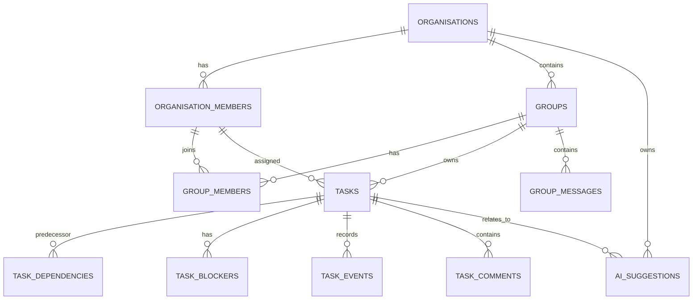

# Coop: Plan of Action and Product Requirements

> **Living document.** This is the single source of truth for what Coop is, what it must do, and how far we have got.
> It is updated at the end of every development phase.
> Status legend: ✅ Done · 🟡 In progress · ⬜ Not yet started

Last updated: 2026-11-10 (Phases 1 to 4 built; Phases 5 and 6 partly built)

---

## 1. Vision

**Coop** is an AI-assisted workspace for coordinating and cooperating on shared work.
It addresses one problem: **communication around work in progress**.

People who work together on tasks should:

1. maintain communication,
2. complete their assigned tasks efficiently and report them back,
3. understand that their role matters to the whole task.

When someone cannot finish their part, they become a **blocker** for people who are doing their work diligently.
Coop exists to:

- surface **blockers** immediately so that quick decisions can be made,
- keep the **necessary information** (context) in one place so that nobody has to remember it,
- keep every task **updated** each time a subtask or related job is done,
- help people finish **specific tasks by specific deadlines**,
- give **higher management** an AI-generated picture of overall progress, without surveillance.

> In simple words: an AI-assisted coordination and cooperation platform that helps people finish their work faster.

---

## 2. Core product principles

| # | Principle | What it means in practice |
| --- | --- | --- |
| P1 | **A task is a persistent, stateful object** | A task evolves through employee actions, conversations, dependencies and verified events. It is not a to-do line. |
| P2 | **Hybrid interaction** | People interact with tasks in two ways: (a) **structured**: create, assign, change state, report blockers, record progress; (b) **natural**: group and task discussions that the AI interprets to *suggest* updates. Both feed the **same task engine**. |
| P3 | **The AI is never the source of truth** | Postgres and the backend state machine are authoritative. The AI only writes **suggestions**. A human confirms, and the engine validates, applies and records the change. |
| P4 | **Every state change is an immutable event** | We store an **event history plus a current-state record**, not full event sourcing. This is simpler to operate and enough for the MVP. |
| P5 | **Status ≠ Progress ≠ Blocker ≠ Dependency** | These are four separate concepts, stored separately (see §6). |
| P6 | **No blame, no surveillance** | The AI reports *what work was done* and *what is preventing progress*. It must not assign blame or infer that someone is deliberately delaying work. |
| P7 | **Bring your own AI** | Managers and team members can plug in their own AI agents later. The schema already supports this (`ai_agents`). |

---

## 3. Domain architecture

```
Organisation
 ├── Organisation members (owner / admin / member)
 └── Groups (e.g. Management, Engineering, Operations, Finance)
      ├── Group members (group admin / member + per-member permissions + functional role)
      ├── Discussions (group messages)            ─┐
      ├── Context documents (admin-controlled)      ├──► AI interpretation ──► AI suggestions ──► human confirms
      └── Tasks (stateful objects)                 ─┘                                                │
           ├── Subtasks (parent_task_id)                                                             ▼
           ├── Dependencies (directed acyclic graph)                              Task engine (Postgres functions)
           ├── Blockers (first-class objects)                                     validates → applies → records event
           ├── Events (immutable history)
           ├── Comments (task-specific discussion)
           └── Evidence (links / files / notes proving work)

Task intelligence engine: states, events, dependencies, blockers, AI suggestions
Operational dashboard: progress, workload, risks, handoffs, deadlines
```

### 3.1 Entity relationship (reference diagram from product owner)



**Tables added on top of the reference diagram:** `profiles` (1:1 with auth users), `invitations`, `task_evidence`, `context_documents`, `ai_agents` (bring-your-own agents), and `task_status_transitions` (the state machine as data).

---

## 4. Roles and permissions

| Role | Scope | Can do |
| --- | --- | --- |
| **Organisation owner** | Organisation | Everything. Created automatically for whoever creates the organisation. |
| **Organisation admin** | Organisation | Manage members and invitations, see and administer every group. |
| **Organisation member** | Organisation | Create groups (and become that group's admin), join groups they are invited to. |
| **Group admin** (like a WhatsApp group admin, i.e. the manager) | Group | Set the group goal and context, add or remove members, create and assign tasks, review, cancel and reopen tasks, see everyone's tasks. |
| **Group member** | Group | See the group board, update **their own** tasks, report blockers, comment, discuss. |
| **Per-member permissions** (granted by the group admin) | Group | `can_create_tasks`, `can_schedule_tasks`, `can_assign_tasks`, `can_upload_context` |
| **Functional role** (free text) | Group | e.g. "Frontend", "Backend", "Database". The AI uses it to break down work and assign it. |

**Roles when adding people to a group:** when the group admin adds or invites someone, they can give that person a **functional role** (stored in `group_members.functional_role`, with `role_source = 'admin'`).
The AI assigns subtasks according to these roles.
If no role is given, the AI **infers one** from the goal and context the admin provided. The inferred role arrives as an `ai_suggestions` row (`kind = 'assign_role'`). Once the admin accepts it, the role is written with `role_source = 'ai'` and stays editable. The AI never overwrites a role the admin set.

**Context-document control:** by default, **only the group admin** can provide the goal or task and its context documents. The group setting `members_can_upload_context` or the per-member `can_upload_context` permission can open this up. This stops unrelated content from piling up.

---

## 5. Anatomy of a task

| Component | Fields / tables |
| --- | --- |
| **Identity** | `id`, human key `<ORG-PREFIX>-<task_number>`, `title`, `description`, `acceptance_criteria`, `parent_task_id` (subtasks) |
| **Ownership** | `created_by`, `owner_id` (organisation member), `reviewer_id` |
| **Life cycle** | `status` (state machine), `status_changed_at`, `priority` |
| **Dependencies** | `task_dependencies` (directed edges, finish-to-start for the MVP) |
| **Blockers** | `task_blockers` (first-class, with their own lifecycle) |
| **Timeline** | `start_date`, `due_date`, `started_at`, `submitted_at`, `completed_at`, `cancelled_at` |
| **Evidence** | `task_evidence` (links, files, notes) |
| **History** | `task_events` (immutable, append-only) |
| **Intelligence** | `ai_suggestions`, `risk_level`, `ai_summary`, `ai_assessed_at` |

---

## 6. Four concepts that must not be confused

| Concept | Question it answers | Where it lives |
| --- | --- | --- |
| **Status** | Which state is the task in right now? | `tasks.status` (state machine only) |
| **Progress** | How much of the expected work is done? | `tasks.progress` (0 to 100) |
| **Blocker** | What is *actually* preventing progress? | `task_blockers` |
| **Dependency** | What other work *must* happen before this task can progress? | `task_dependencies` |

_Example:_ a task can be **60% complete** and **blocked** because the remaining work needs an external approval. We never squeeze these into one status field.

---

## 7. Task state machine (MVP)

States: `draft` → `ready` → `in_progress` ⇄ `blocked` → `in_review` → `completed`, plus `cancelled`.

| From | To | Condition | Who may do it | Reason required |
| --- | --- | --- | --- | --- |
| draft | ready | Requirements and owner are established, and all dependencies are satisfied | Group admin, task creator | No |
| ready | in_progress | Owner starts work, and all dependencies are satisfied | Owner, group admin | No |
| in_progress | blocked | A blocker is reported **and confirmed** | Owner, group admin (also automatic when a blocker is confirmed) | No |
| blocked | in_progress | All confirmed blockers are resolved | Owner, group admin (also automatic when the last blocker is resolved) | No |
| in_progress | in_review | Work is submitted for verification | Owner, group admin | No |
| in_review | completed | The reviewer accepts the outcome | Reviewer, group admin | No |
| in_review | in_progress | The reviewer or manager requests changes | Reviewer, group admin | **Yes** |
| completed | in_progress | Explicit reopening | Reviewer, group admin | **Yes** |
| any active state | cancelled | Authorised cancellation | Group admin | **Yes** |

Rules:

- **No arbitrary transitions.** For example, `draft` cannot go directly to `completed`. The allowed transitions are stored as data (`task_status_transitions`) and enforced by the `transition_task()` Postgres function.
- Clients **cannot write `tasks.status` directly**, because column privileges are revoked. Every state change goes through the engine.
- **Every transition writes an immutable `task_events` row** (who, from, to, reason, when).
- Optimistic concurrency: `tasks.version` is bumped on every change, and callers can pass the version they expect.

### 7.1 Kanban board mapping

The board shows the three columns that were asked for, and each card still shows its precise status:

| Kanban column | Underlying statuses |
| --- | --- |
| **Yet to start** | `draft`, `ready` (a "waiting" badge shows when dependencies are unmet) |
| **In progress** | `in_progress`, `blocked`, `in_review` |
| **Done** | `completed` |
| _(hidden, shown with a filter)_ | `cancelled` |

---

## 8. Dependency model

- Dependencies form a **directed graph**: each task is a node, and each dependency is a directed edge `predecessor → successor`.
- **MVP type: finish-to-start (FS).** Task B cannot become ready, or start, until task A is completed.
- **Future types:** the enum already exists, but a check constraint disables these types for now.

| Type | Meaning | Status |
| --- | --- | --- |
| Finish → Start (FS) | B starts after A finishes | ✅ MVP |
| Start → Start (SS) | B starts after A starts | ⬜ Future |
| Finish → Finish (FF) | B finishes after A finishes | ⬜ Future |
| Start → Finish (SF) | B finishes after A starts | ⬜ Future |

**Linking flow** (`add_task_dependency()`):

1. Check that both tasks exist and that the caller can access them.
2. Check whether the new edge would introduce a **cycle**.
3. Create the dependency.
4. Recalculate the successor's readiness. If any predecessor is incomplete, the successor is **waiting** and cannot become ready.
5. When a predecessor completes, every successor whose dependencies are now all satisfied gets a `dependency_satisfied` event and becomes **eligible** for `ready`. It is not moved automatically. A task with several dependencies stays waiting until **all** of them are satisfied.

**Worked example (deployment workflow):**
QA assessment (A, completed) → consolidated report (B, employee B, in progress) → finalise deployment schedule (C, employee C, waiting on B) → approve deployment (D, department head, not started).

### 8.1 Cycle detection

The graph must stay **acyclic**. A → B → C → A is invalid because every task would wait for another task in the same cycle.

- Detection: a **recursive Postgres query** (`would_create_cycle()`) runs before any edge is accepted.
- A trigger also checks for cycles as a backstop, so a direct insert cannot create one either.
- An advisory lock per organisation serialises concurrent edge inserts, so that two simultaneous inserts cannot create a cycle together.

---

## 9. Blocker model

**Dependencies are not blockers.** A dependency is an *expected* relationship between pieces of work. A blocker is an *actual* impediment.
_Example:_ "B depends on A" is a dependency. "A is waiting for an approval that hasn't arrived" is a blocker. A task can have several of each, and they are stored separately.

A blocker is a **first-class object** with title, description, category (`approval`, `information`, `dependency`, `resource`, `technical`, `external`, `other`), affected task, optional blocking task, resolution owner, suggested resolution, and downstream impact.

**Blocker lifecycle** (the AI must keep these distinct):

| Status | Meaning |
| --- | --- |
| `potential` | **Inferred** by the AI from a discussion. Not yet confirmed by a human. |
| `reported` | Reported by a person through the structured "Report blocker" flow. |
| `confirmed` | Validated by the task owner or a group admin. Puts an in-progress task into `blocked`. |
| `resolved` | Resolved. When the last confirmed blocker is resolved, a blocked task returns to `in_progress`. |
| `dismissed` | Not a real blocker. |

### 9.1 Hybrid interaction flow (blockers)

1. **Structured:** the employee clicks **Report blocker**, selects a category, explains the issue and submits.
2. **Natural:** the employee writes in the task discussion: _"I'm waiting for the revised financial figures before I can proceed."_
3. **AI interpretation:** the AI detects a possible blocker, identifies the affected task, and looks for an existing dependency or blocker record. It then creates an `ai_suggestion`. _Example:_ title "QA assessment review pending", affected task "Consolidated report", category `approval`, suggested resolution owner "QA reviewer", downstream impact "Deployment scheduling".
4. **Human confirmation** of the suggestion.
5. **Task engine** validates the change, records an event, and recalculates the affected tasks.

---

## 10. AI layer (design is deferred and will be discussed later)

| Capability | Description |
| --- | --- |
| Goal breakdown | From the group goal, context documents and member roles: estimate difficulty, identify the required information, break the goal into subtasks, and propose an owner for each subtask (the number of people is inferred from group membership and context). |
| Starting advice | For each subtask: how to start, plus an optional further breakdown into smaller steps. |
| Discussion interpretation | Detect possible blockers, progress updates and new tasks in group messages and task comments, and turn them into suggestions. |
| Progress intelligence | Summarise the state of a task or goal for higher management, and run risk assessments and recommendations. |
| Clearance analysis | Analyse each employee's task clearance dashboard (completion rate, on-time rate) constructively, without blame. |
| Bring your own agents | Managers and members register their own agents (`ai_agents`: provider, model, endpoint, Vault secret reference). Agentic workflows come later. |

Every AI output lands in `ai_suggestions` (`pending` → `accepted`/`rejected` → `applied`) and never touches tasks directly.

---

## 11. User interface requirements

- Simple UI with **lazy loading** (route-level code splitting, `next/dynamic` and Suspense skeletons).
- **Very light, smooth animations** (CSS transitions and keyframes only, and they respect `prefers-reduced-motion`).
- **Light and dark themes** (system default plus a toggle). _Colour palette: to be decided with the product owner._
- **Sidebar** navigation.
- **Landing page** (`/`): stop-motion style reveals, smooth (inertial) scrolling, a hands-on demo of the hybrid blocker flow, a feature card slider, and calls to action that lead to the app ("Who are you?" while sign-in is paused).
- Authentication: **email and password** plus **Google OAuth**. ⏸ _Paused for the prototype (see §12.1): you pick who you are instead._
- **Profile**: personal details, and adding other people.
- **Group creation**: name plus a common goal or task.
- **Kanban board** per group (Yet to start / In progress / Done).
- **Personal view** (my tasks) and **manager view** (everyone's tasks in the group). This lists *tasks done*, never activity tracking.
- **Task clearance dashboard** per employee.
- **Operational dashboard**: progress, workload, risks, handoffs, deadlines.
- _UI design inputs from the product owner are pending (see §15)._

---

## 12. Technical architecture

The code is split into two folders: **`frontend/`** and **`backend/`**.

| Layer | Choice |
| --- | --- |
| Frontend (`frontend/`) | React 19 + Vite, React Router (every page lazy-loaded), TanStack Query, Tailwind CSS v4, `lucide-react`. All data goes through the backend API; the frontend does not talk to Supabase. Code is organised by feature (`src/features/<module>`). |
| Backend (`backend/`) | Next.js 16 **REST API** (`/api/v1/*`, route handlers only): acting-person header (prototype mode, §12.1), input validation with `zod`, Postgres error → HTTP status mapping, CORS for the frontend. The same API will serve bring-your-own AI agents later. |
| Task engine | **Postgres functions** (`transition_task`, `add_task_dependency`, `report_blocker`, …). They are authoritative, atomic and write events in the same transaction. The backend mirrors the transition rules only to *display* the actions a person may take. |
| Database | **Supabase Postgres** with Row Level Security on every table |
| Auth | ⏸ Paused (prototype mode, §12.1). Planned: Supabase Auth (email/password, Google OAuth) with the user's JWT forwarded by the API. |
| Storage | Supabase Storage bucket `context-documents` (private, path `<group_id>/…`) |
| Realtime | Supabase Realtime publication on tasks, events, messages and comments (UI wiring comes in a later phase) |
| AI | Deferred. The schema is ready (`ai_suggestions`, `ai_agents`). |

### 12.1 Prototype mode without sign-in (since 2026-11-10)

Sign-in is switched off so the team can focus on features. There was no earlier version without sign-in to roll back to, so it was removed.

- **Who you are:** the "Who are you?" screen (`/welcome`) lists people. You pick one or add yourself. The choice is remembered in the browser and sent to the API on every request in the `X-Coop-Actor` header. "Switch person" in the sidebar changes it, which is also how you test features from another team member's point of view.
- **How Postgres knows:** the API calls Supabase with the server-only **secret key** and the actor header. Migration `…000800` installs a PostgREST pre-request hook that, for secret-key requests only, makes `auth.uid()` return that person. Every engine function and permission check written for real sign-in still runs unchanged. The public (publishable) key cannot use the header.
- **People without accounts:** `profiles` no longer requires an `auth.users` row. `create_person` and `add_organisation_member` add people directly; invitations are removed from the API and UI for now (the table stays).
- ⚠️ **No security while in this mode:** anyone who can reach the API can act as anyone. Keep real data out of the database.

**Turning sign-in back on (Phase 12):** unset `pgrst.db_pre_request` on the `authenticator` role; re-add the `profiles.id → auth.users` foreign key (`not valid` first, then link or remove people created without accounts); have the API forward each user's JWT with the publishable key again instead of the secret key; restore the login, signup, OAuth callback and invitation screens and endpoints from git history (commit `4776c18` and earlier).

---

## 13. Development phases

| Phase | Feature | Outcome | Status |
| --- | --- | --- | --- |
| **Phase 1** | Foundation: separate `frontend/` (React + Vite) and `backend/` (Next.js REST API) folders, complete database schema and migrations (all entities, enums, RLS, storage), app shell (sidebar, light and dark theme, lazy loading, light animations), auth (email/password + Google OAuth), profile page | A secure, themed app that users can sign up for and log into. The full data model, with every relationship, exists in Postgres. | ✅ Done (sign-in paused since 2026-11-10, see §12.1) |
| **Phase 2** | Organisations, groups and membership: onboarding (create organisation), create groups with a goal, invitations (organisation and group), group roles, functional roles, per-member permissions | A manager can create an organisation and a group, set a goal, invite people and control what each member may do. | ✅ Done |
| **Phase 3** | Task engine and Kanban: manual task creation, subtasks, owner and reviewer assignment, state machine transitions, progress updates, immutable event history, Kanban board (3 columns), task detail view | Teams can run work end to end on a board. Every state change is validated by Postgres and recorded as an event. | ✅ Done |
| **Phase 4** | Dependencies and blockers: finish-to-start links with cycle detection, waiting and eligibility indicators, first-class blockers (report, confirm, resolve, dismiss) with automatic blocked and unblocked transitions | Blockers become visible immediately, and downstream tasks know exactly what they are waiting for. | ✅ Done |
| **Phase 5** | Discussions: group chat and task comments with Supabase Realtime, live board updates | Natural conversation happens next to the work and updates in real time. | 🟡 In progress (task comments done; group chat and realtime not yet started) |
| **Phase 6** | Dashboards: personal task clearance dashboard, manager operational dashboard (progress, workload, risks, handoffs, deadlines) | Each employee sees how they are doing, and managers see the state of the whole group at a glance. | 🟡 In progress (basic personal dashboard done) |
| **Phase 7** | Context documents: upload, list and preview, admin-only by default, configurable permissions, text extraction | The AI and the team share the same, controlled source of context. | ⬜ Not yet started |
| **Phase 8** | AI layer I: goal analysis (difficulty, required information), breakdown into subtasks, AI-proposed assignment by role, starting advice. Everything goes through `ai_suggestions` with human confirmation | A manager enters a goal and gets a reviewed, assigned task plan in minutes. | ⬜ Not yet started |
| **Phase 9** | AI layer II: discussion interpretation (potential blockers, progress and new-task suggestions), risk assessment, management progress summaries | Natural conversation turns into structured, confirmed task updates, and management gets AI status reports. | ⬜ Not yet started |
| **Phase 10** | Bring-your-own AI agents: register agents (provider, model, endpoint, Vault secret), per-group and per-user scope, a public API for agents, then agentic workflows | Teams can use their own AI agents on Coop tasks. | ⬜ Not yet started |
| **Phase 11** | Advanced scheduling and hardening: SS, FF and SF dependency types, notifications (email or in-app), deadline reminders, audit views, tests, performance and accessibility pass | Production-ready scheduling and reliability. | ⬜ Not yet started |
| **Phase 12** | Turn sign-in back on: email/password and Google OAuth, invitations by link and email, remove prototype mode (§12.1) | Real accounts and private data. | ⬜ Not yet started (paused on purpose) |

**How Phases 1 to 4 were verified (2026-11-10):**

- All 7 migrations apply cleanly to Postgres 17 (PGlite). `npm run test:db` passes 40+ engine checks, covering the state machine, cycle detection, blockers, immutable events, RLS, column privileges and storage policies.
- The backend and frontend both typecheck, lint and build.
- The API was smoke-tested for health, the auth guard, CORS and SPA routing.
- 2026-11-10, prototype mode: migration `…000800` applies cleanly and 11 new checks pass (acting as a person through the pre-request hook, the public key cannot use it, people without accounts, adding people). The "Who are you?" → onboarding flow was clicked through in Edge against a stand-in API with no page errors.
- ⚠️ **Not yet run against a live Supabase project** (no Docker on the development machine). The first manual click-through after connecting Supabase is the remaining check.

### 13.1 Feature checklist

| Feature | Phase | Status |
| --- | --- | --- |
| Email + password login | 1 → 12 | ⏸ Paused (prototype mode) |
| Google OAuth login | 1 → 12 | ⏸ Paused (prototype mode) |
| "Who are you?" person picker and "Switch person" (prototype mode) | 1 | ✅ |
| Sidebar, light and dark theme, lazy loading, light animations | 1 | ✅ |
| Public landing page: hero, interactive demo of the blocker flow, feature slider, FAQ; links into the app | 1 | ✅ |
| Profile (details) | 1 | ✅ |
| Full database schema + migrations + RLS | 1 | ✅ |
| Create organisation | 2 | ✅ |
| Create group with goal | 2 | ✅ |
| Add people directly to the organisation and groups (prototype mode) | 2 | ✅ |
| Invite people by link or email | 2 → 12 | ⏸ Paused with sign-in |
| Group admins, member permissions, functional roles | 2 | ✅ |
| Role assigned when adding or inviting a member (empty = AI will infer) | 2 | ✅ (admin-assigned roles). AI inference ⬜ Phase 8 |
| Manual task creation and subtasks | 3 | ✅ |
| State machine + immutable events | 3 | ✅ |
| Kanban board (Yet to start / In progress / Done) | 3 | ✅ |
| Progress (0 to 100%) separate from status | 3 | ✅ |
| Finish-to-start dependencies + cycle detection | 4 | ✅ |
| Blockers as first-class objects with a lifecycle | 4 | ✅ |
| Task comments | 5 | ✅ |
| Group discussions (chat) | 5 | ⬜ Not yet started (schema ready) |
| Realtime updates | 5 | ⬜ Not yet started (publication ready) |
| Task clearance dashboard (per employee) | 6 | 🟡 In progress (basic stats) |
| Operational dashboard (manager) | 6 | ⬜ Not yet started |
| Context documents with admin control | 7 | ⬜ Not yet started (schema and storage ready) |
| AI goal breakdown + auto-assignment | 8 | ⬜ Not yet started |
| AI starting advice | 8 | ⬜ Not yet started |
| AI discussion interpretation (blockers, updates) | 9 | ⬜ Not yet started |
| AI risk assessment + management summaries | 9 | ⬜ Not yet started |
| Bring-your-own AI agents | 10 | ⬜ Not yet started (schema ready) |
| SS, FF and SF dependency types | 11 | ⬜ Not yet started (enum ready) |
| Notifications and reminders | 11 | ⬜ Not yet started |

---

## 14. Decisions log

| Date | Decision | Why |
| --- | --- | --- |
| 2026-11-10 | Event history + current-state record, not full event sourcing | Simpler to operate and enough for the MVP |
| 2026-11-10 | The state machine is enforced in Postgres (`transition_task`), with direct `status` writes revoked | Postgres must stay authoritative, even against buggy clients or AI |
| 2026-11-10 | Cycle detection in Postgres (recursive CTE + trigger backstop + advisory lock) | Correct under concurrency, and impossible to bypass |
| 2026-11-10 | "Waiting" is a derived flag (unmet dependencies), not a state | Keeps the state machine small. Readiness is recalculated automatically. |
| 2026-11-10 | Confirming a blocker moves an in-progress task to `blocked`. Resolving the last one moves it back. | Less manual bookkeeping. Both moves are recorded as events. |
| 2026-11-10 | Tasks are assigned to **organisation members** (as in the ER diagram). The engine checks that the owner is also a member of the group. | Matches the reference diagram |
| 2026-11-10 | Groups are visible to their members and to organisation owners and admins | Privacy between departments. Management can still oversee. |
| 2026-11-10 | Code is split into `frontend/` (React SPA) and `backend/` (Next.js REST API), as the product owner asked | Clear separation. The same REST API will serve bring-your-own AI agents. |
| 2026-11-10 | The API calls Postgres **as the user** (it forwards their JWT) instead of using a service key | RLS protects every request, even if there is a bug in the API |
| 2026-11-10 | A functional role can be set when adding or inviting a member. An empty role becomes an AI suggestion that an admin approves. | Product owner request. The AI never overwrites a role an admin set. |
| 2026-11-10 | Colour palette and detailed UI design deferred | The product owner will provide design input |
| 2026-11-10 | Sign-in paused: prototype mode with a "Who are you?" picker. The API acts as the chosen person through a Postgres pre-request hook (§12.1). | Product owner request, to focus on features. No auth-free version existed to roll back to. The hook keeps every permission check working, so turning sign-in back on is small. |
| 2026-11-10 | Frontend code is organised by feature (`frontend/src/features/<module>`), keeping the `frontend/` and `backend/` folder names | Product owner request: folder names follow the product's modules. Keeping the top-level names avoids reconfiguring Vercel and the Supabase GitHub integration. |

---

## 15. Open questions

1. **UI design:** colour palette, typography, density, and the Kanban card layout (deferred by the product owner).
2. Should a task support **several assignees** (collaborators) in addition to a single accountable owner?
3. Who reviews by default when a task has no reviewer: the group admin, or a dedicated reviewer role?
4. Should members be able to see tasks from other groups in the same organisation (cross-group dependencies)?
5. Should invitations be sent by email (Supabase SMTP or Resend), or are copyable links enough for now?
6. AI provider and model preferences for the built-in AI layer (Phase 8).

---

## 16. Master plan v2: Workspace Efficiency Manager (from 2026-11-10)

The product owner's master development prompt replaces the phase plan in §13 from here on. Work goes **phase by phase**: build a phase, test it (happy paths, edge cases, failure cases), and only start the next phase once its tests pass. **The task engine is built before any new UI**, and no new UI work happens until the engine is done. A screen counts as complete only when it is wired to real backend behaviour.

### 16.1 Decisions taken at the start of v2

| Question | Decision |
| --- | --- |
| Blocker lifecycle | **Merged:** `reported` → `confirmed` (shown as "Open") → `in_resolution` → `resolved`, or `dismissed`. AI-detected blockers become AI suggestions; accepting one creates a blocker. `potential` is no longer used. |
| Database access | **Keep the Supabase REST API with the secret key.** RLS is bypassed, so tenant isolation is enforced in the API and in the engine's SECURITY DEFINER functions, and proven with adversarial cross-tenant tests at the API level. |
| Authentication timing | **Now, before the task engine** (spec Phase 2). Prototype mode (§12.1) is replaced: the API verifies the user's JWT and tells Postgres who is acting. |

### 16.2 Phases

| Phase | Scope | Exit criteria | Status |
| --- | --- | --- | --- |
| **v2-1** Discovery & architecture | Review the repo; gap analysis against the spec; decisions; test infrastructure plan | This section; local test database running | ✅ Done (2026-11-10) |
| **v2-2** Foundation | Auth module (JWT verification, session expiry, disabled accounts, invitation lifecycle, organisation switching, profile, preferences, deactivation); structured errors, logging, correlation IDs; API test harness against the Supabase project | Auth test cases (spec §19.1) pass at the API level; first k6 baseline recorded | 🟡 In progress: database tests ✅; API tests wait for migration 800 on the Supabase project (§16.4) |
| **v2-3** Task engine v2 | Contributors; expected outcome; optional projects; owner required from `ready` on; merged blocker lifecycle with resolution owner; cross-group dependencies with permission checks; readiness and downstream-impact functions; idempotency keys; member removal with reassignment; API-level tenant isolation | Spec §19.2–19.4 test cases pass; transition and dependency p95 measured with k6 | ⬜ Not yet started |
| **v2-4** Collaboration & notifications | Group threads and replies, task discussions, mentions and task references, notifications (in-app, read/unread, grouping, preferences), realtime with resync | Spec §19.5 test cases pass | ⬜ Not yet started |
| **v2-5** AI service | Python service; action extraction, blocker and dependency suggestions, suggestion review workflow, idempotency, retries, cost tracking, prompt-injection defences | Spec §19.6 test cases pass; core works with AI down | ⬜ Not yet started |
| **v2-6** Hardening | Security tests, RLS and tenant verification, load tests at 100 / 1,000 / 10,000 VUs, accessibility, observability | Measured results in the performance report | ⬜ Not yet started |
| **v2-7** Release readiness | Production migrations, secrets, backups, monitoring, rollback, smoke tests | Checklist signed off | ⬜ Not yet started |
| **v2-UI** Delightful UI | Design system, board, task workspace, dashboards, interaction system (spec §3), built around the finished engine | Every screen backed by real API behaviour; Playwright + Web Vitals measured | ⬜ After v2-3 |

### 16.3 Gap analysis: spec vs. current build

| Spec requirement | Current state | Phase |
| --- | --- | --- |
| State machine, immutable events, atomic transitions, optimistic concurrency | ✅ Built and tested (Postgres functions, `version` column) | Re-verify in v2-3 |
| Finish-to-start dependencies, cycle prevention | ✅ Built and tested | v2-3 (cross-group, impact) |
| Readiness separate from status ("waiting on N") | ✅ `unmet_dependency_count` | v2-3 (approvals, notifications) |
| Downstream impact calculation | ❌ Missing | v2-3 |
| Contributors (many), expected outcome, projects | ❌ Missing (`acceptance_criteria` exists) | v2-3 |
| Blockers with resolution owner, merged lifecycle | 🟡 Columns exist; lifecycle differs | v2-3 |
| Member removal with reassignment | ❌ Missing | v2-3 |
| Idempotency keys for important writes | ❌ Missing | v2-3 |
| Tenant isolation | 🟡 Engine functions check membership; direct table reads through the secret key do not | v2-2 / v2-3 |
| Auth: register, login, verify, reset, invitations, deactivation | ⏸ Removed for prototype mode; code is in git history | v2-2 |
| Invitation expiry | 🐞 Accepting an expired invitation rolls back its own "expired" update | v2-2 |
| Notifications, attachments, user preferences tables | ❌ Missing (`task_evidence` covers part of attachments) | v2-2 / v2-4 |
| Group threads, mentions, task references | 🟡 `group_messages.reply_to_id` exists; no API | v2-4 |
| AI suggestions with review workflow | 🟡 Table exists; statuses include `applied` | v2-5 |
| Structured logs, correlation IDs, health checks | 🟡 Health route only | v2-2 |
| k6 load tests, Playwright, performance report | 🟡 Report started (`docs/PERFORMANCE.md`); k6 v2.3.0 and Playwright available | Every phase |

### 16.4 Test infrastructure

- **Decision (2026-11-10): API and load tests run against the Supabase project itself**, not a local copy. Nothing extra is installed (no PostgREST, no Docker). Consequences, to be stated next to every result: (1) latency includes the round trip from the dev machine to Supabase (44–67 ms warm, measured); (2) the project's plan limits cap how much load can be applied, so the 1,000 and 10,000 virtual-user levels may not be reachable and will be reported as "not measured" if so; (3) tests write to the real database, so every test creates its own organisation with a `zz-test-` prefix and deletes it afterwards.
- **Local Postgres** (`backend/scripts/local-stack.mjs db`): a disposable PostgreSQL 17 cluster in `backend/.local/pg` on port 54329, used only for the database-level engine tests. It never touches other Postgres servers on the machine. The PostgREST part of that script is unused.
- **Database tests:** `npm run test:db` (PGlite, in memory) and `npm run test:db:pg` (real Postgres 17, rebuilt before every run). Both pass.
- **API tests:** Vitest against the backend running locally and connected to the Supabase project. Test users are created through Supabase Auth's admin API (secret key) and sign in for real, so the tokens are genuine. Email delivery (sign-up confirmation, password reset) is checked by hand.
- **Load tests:** k6. **Browser tests:** Playwright with the installed Edge.
